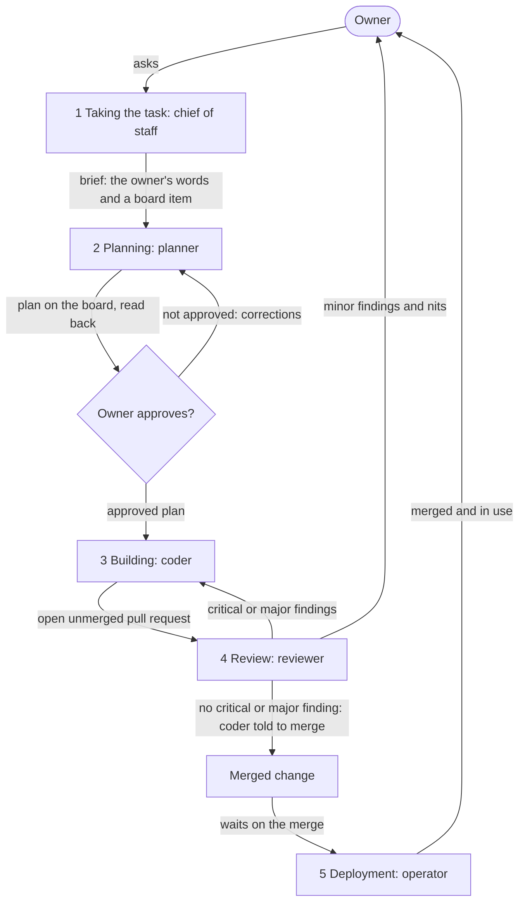

# The Chief of Staff workflow

Five roles: chief of staff, planner, coder, reviewer, operator. Five stages, in order: taking the task, planning, building, review, deployment.

The chief of staff carries every hand-off and tells the owner once when the work is finished. Findings go back to the coder until none is critical or major. Deployment starts only when the merge has happened.

## Rules every role follows

1. One path for every task, whatever its size and even when its requirements are already approved: planner, the owner's approval, coder, reviewer, operator. Never brief the operator or any other mind to build, and never skip the planner, unless the owner says so specifically for that task.
2. An approved requirement is the answer. When today's behaviour differs from it, today's behaviour is what the feature changes: plan the change and say so in one line. Never ask the owner whether an approved requirement should give way to how things work now.
3. When something looks unsettled, read the design, the approved requirements and the protected behaviours on the board item first and take the answer from them. How a requirement is met is an engineering choice: pick the smallest mechanism that meets it, record it, keep going.
4. A question goes to the owner only when those do not answer it: a real gap none of them covers, two approved requirements that cannot both hold, a requirement that cannot be built as written, or work that means touching something put off limits or something destructive nobody authorised. Never quietly rewrite an approved requirement and never build past one known to be wrong.
5. The plan was agreed by a mind that could not see the code, so it is incomplete by construction. A gap that the approved requirements, the module's conventions or the design document already determine is closed by the coder, put on the board row as a new numbered requirement, and named in the ship report.
6. The owner is asked at two stops, both before any code: the requirements read-back and the protected-behaviour read-back. After that nothing asks for approval or confirmation to continue. Approving a plan authorises the whole feature, built to merged and pulled.
7. Write a question to the owner in words a person who has never seen the code would understand: no story numbers without saying what the story is, the exact thing named, one sentence of why it matters.
8. A briefed mind closes its turn with one plain paragraph: done, not done or broken, with any question for the owner. Every prompt given to a sub-mind ends with: "Give one final message only. Put the whole result in it. Do not add a separate summary, recap or closing note after it."
9. "Dispatched" and "that mind says it is green" are different sentences; the owner is owed whichever is true. Say what was verified and how, and what could not be verified and why.
10. In everything said to the owner a background child is a "sub-mind", never a "helper" and never a "sub-agent". A sub-mind's finding is evidence, not authority: check it against the code, and kill it only when the claim has been checked and is wrong.
11. A reviewer did not write the change, reads the actual code and not an account of it, reads and reports and never fixes, and says plainly when it found nothing rather than padding. Every finding is marked critical, major, minor or nit; critical and major hold the merge, minor and nit go to the owner, who says which to fix.
12. Keys are never printed. Every brief to a mind says: never print a file that holds keys, such as a mind's runtime configuration or any environment file; read the one line needed, or print it with values masked; never repeat a key found in a transcript, only where it is. A credential never goes on a command line: pass it through standard input or a header file deleted afterwards.
13. The board is the only backlog, reached only through the board tool, never by raw SQL: the ordering, the hierarchy numbering and the write lock live above the table.
14. A board item is its id, not its dotted number. The dotted number is only its current position and changes when the story is moved; name items by id in briefs and reports.
15. Lanes: committed once the requirements are approved, in progress when building starts, done only after merged and pulled. Abandoned or blocked work goes back to committed with the reason added.
16. Finished means in use: merged, rebuilt, restarted or recreated, whatever the container or the target needs. A file on disk updated is not a deploy, because a running process keeps what it loaded at startup. Every brief that assigns work carries this as what done means.
17. The coder returns one open, unmerged pull request. Merging, moving board rows to done and restarting services wait for a review with no critical or major finding and the coder being told to merge; a step that waits on the merge is briefed only after it. Nothing is restarted or recreated while something is running that it would cut off: look for an idle moment.
18. Build in your own worktree and branch; never switch branches, commit or edit inside a tree another mind is working in. Once merged, the worktree is deleted, locally and on the remote, and its branch with it. Every brief that assigns code carries that as part of what done means.
19. A test may never insert anything into production. Code whose job is to write into production is not wrapped by a test: bring the owner the behaviour, what it writes and where, and how it might be tested safely, and report it unprotected meanwhile. An existing such test is deleted.
20. There is one test standard, a file inside the coder's skill; open it before proposing, writing, changing or deleting a test. Tests protect the approved protected behaviours and nothing else. A behaviour no test can reach is reported as unprotected, never covered by something adjacent.
21. The ship report names what shipped, anything verified by hand rather than by a test, every requirement added, every behaviour left unprotected, and the worktrees removed.

## What each role's mind needs besides its skills

Tiers, by what the install offers. Extra high: its most capable model, for the one role whose mistake costs a whole build. High: a strong model for work that builds or judges. Medium: a capable everyday model. Low: a small, cheap model for one narrow reading.

Chief of staff: medium. Shell, sub-minds, the ledger, board and notify tools. The gateway with its own credential; the admin credential only for the live-feed routes.

Planner: extra high. Shell, files, sub-minds, the board tool with its write credential; read access to every repository.

Coder: high. Shell, files, sub-minds, the board tool; write access to every repository a feature touches, and the right to open pull requests in each.

Reviewer: high, its three lens holders low. Shell, sub-minds, the gateway's broker with its own credential; read-only access to the pull request and the repositories.

Operator: high. Shell, files, sub-minds; the roles tool credential; write access to the shared skills folder; whatever deployment needs.

## Where things live on an install

A generated skill carries, near its top, this declaration, the same in every generated skill:

> This skill belongs to the Chief of Staff workflow. It was written from the stage document `<file name>`. Whoever changes it asks the owner whether to document the change in the workflow.

Generated skills live in one shared folder on the machine, `install/workflow-skills/` in the install's hive_mind checkout. Git ignores it, so a pull never touches it; it is attached read-only to each mind and writable to the operator's mind. The role's copy is changed in place, so every mind holding the role gets the fix at its next conversation; a mind's own differing copy is never overwritten. A generated skill carries the briefs and files for the sub-minds it hands work to inside its own folder, because a role delivers skills and nothing else.

The install's own file is `install/workflow-skills/.install/chief-of-staff.md`. The operator writes it at setup from the owner's answers; no other mind edits a standing order; a pull never touches it. Four sections, in this order, every line dated:

- `## Models and plans`: which model serves each tier, and the plan or quota behind it.
- `## Standing orders`: the owner's instructions that a role obeys without asking.
- `## Routing preferences`: how the owner wants work routed; may name roles.
- `## Notes`: the operator's setup notes: where the private worktree scratch folder lies, and what each role's minds need that the operator cannot give.

Who holds a role is kept nowhere. A mind asks the gateway at that moment, `GET /roles/<slug>/holders` with its own credential, and is told the minds of its own owner that hold the role, as id and name. An empty list means nobody holds it, and that is reported to the owner. A stage that needs a number of holders says how many: the review stage needs three lens holders.

## Documents in this workflow

A stage document is the text of the tuned skills of its stage with install specifics removed. Any stage can be replaced by a document that keeps its hand-offs.

- `taking-the-task.md`: the chief of staff; writes take-a-task and tend-the-ledger.
- `planning.md`: the planner; writes plan-a-task and plan-feature.
- `building.md`: the coder; writes feature, story and task.
- `review.md`: the reviewer; writes review-code and the three lens skills refute-requirements, refute-tests and refute-edges.
- `deployment.md`: the operator; writes the deployment skills as that document says.
